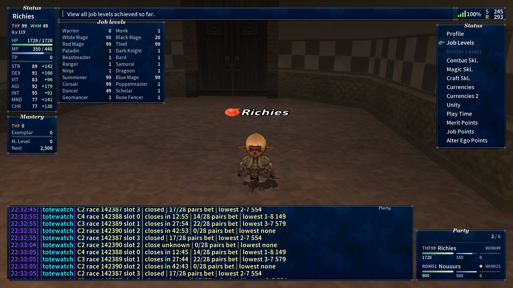
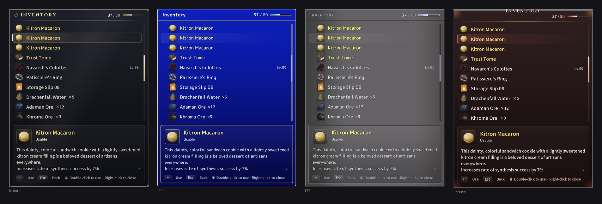
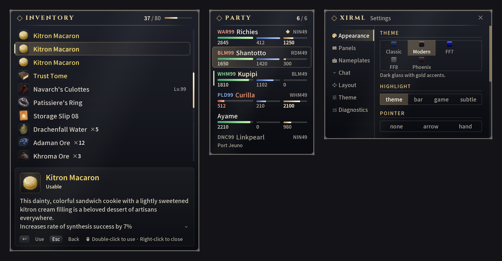
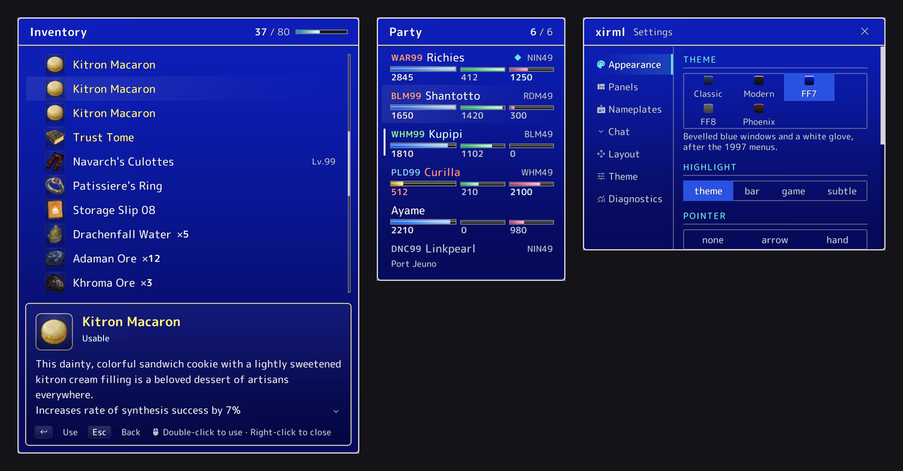
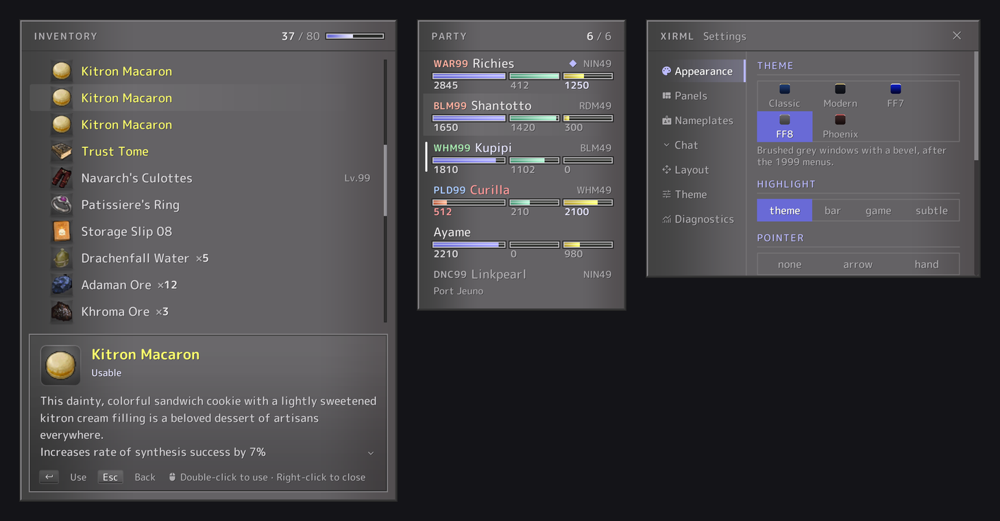
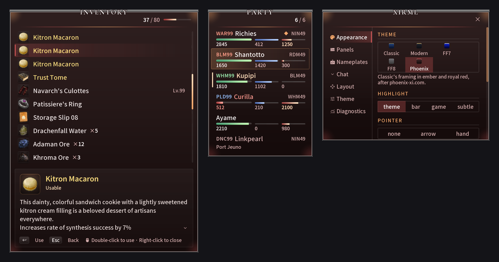
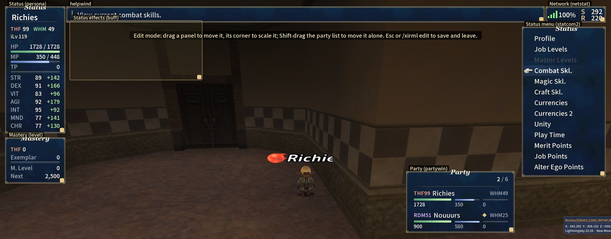
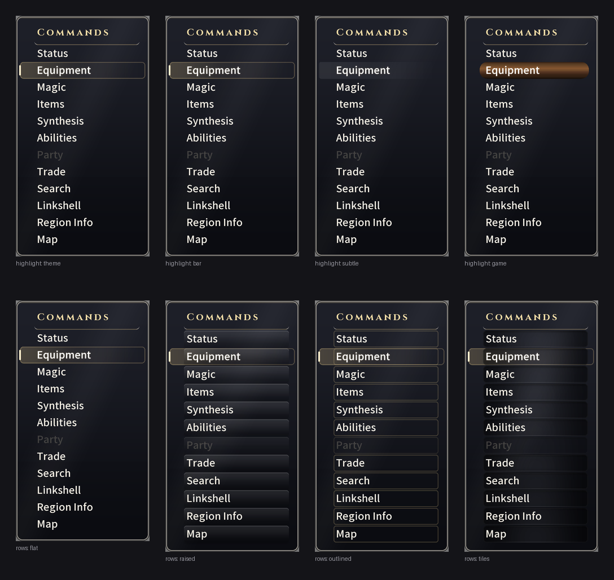

# xirml

A new interface for Final Fantasy XI, as an Ashita v4 plugin.



xirml draws its own panels over the game's windows and keeps them in sync. Your inventory, party list, chat and over
140 menus get a modern look, and you can theme or move any of them.

It's built on [RmlUi](https://github.com/mikke89/RmlUi), a UI library for games that works like HTML and CSS. Every
panel is an RML template and every theme is an RCSS stylesheet, so restyling the game is front-end work, no C++
required. xirml renders RmlUi with its own Direct3D 8 backend, inside the game's frame.

<!-- pictures -->

<!-- /pictures -->

## Features

- Inventory, equipment, party list, target, buffs, chat log, chat input and compass, all redrawn
- Over 140 menus redrawn from the game's own text and buttons. Mouse and keyboard work as usual
- Five themes out of the box, switchable in game
- Move and resize any panel
- Settings panel for themes, fonts, cursors and which windows to replace
- Custom nameplates and compass
- Other addons can put their settings in xirml panels, and ImGui windows pick up your theme's colours
- Live reload: edit a theme or template, run `/xirml reload`, see the change
- If xirml can't read a window, it leaves the original in place and tells you why in chat

<!-- pictures -->
| Modern | FF7 |
|---|---|
|  |  |
| **FF8** | **Phoenix** |
|  |  |

More in the [gallery](https://sruon.github.io/xirml/docs/gallery/).
<!-- /pictures -->

## Move anything

Type `/xirml edit` and every panel shows its name. Drag one to move it, drag its corner to resize it. That works for
menus too. Press Esc to save.



## Install

1. Grab the zip for your Ashita version from [Releases](https://github.com/sruon/xirml/releases).
2. Unzip it into your Ashita folder.
3. In game, run `/load xirml`.

"Latest build" on the releases page tracks main. Tagged `v*` releases are the stable ones. Builds target the newest
Ashita release.

| Command | |
|---|---|
| `/xirml` | Settings |
| `/xirml theme <name>` | Switch theme |
| `/xirml edit` | Move and resize panels |
| `/xirml reload` | Reload themes and templates |

Full docs: [sruon.github.io/xirml](https://sruon.github.io/xirml/)

## Themes

| | |
|---|---|
| `modern` | Dark glass, gold accents. The default |
| `classic` | The game's deep blue windows, redrawn sharp |
| `ff7` | Final Fantasy VII: bevelled blue windows, white glove |
| `ff8` | Final Fantasy VIII: brushed grey windows, blue-violet gauges |
| `phoenix` | Dark red glass, double frame, ember glow |

`classic` (the screenshot at the top) uses the window art from your game install, which is why it's missing from the
gallery. This repository
doesn't contain any game files.

## Cursor styles

Pick how the selected row looks in Settings, Appearance: a highlight, a row style and a pointer (none, the game's arrow
or a hand). Here's the main menu with each highlight, then each row style:



## Make your own theme

A theme is a folder in `ui/themes/` with two files:

```text
ui/themes/my-theme/theme.json    name, description, which theme it builds on
ui/themes/my-theme/theme.rcss    the colours you change, as --name: value; lines
```

Start with [the FF8 walkthrough](docs/theme-authoring.md), then use [the theme reference](docs/themes.md) to look up
tokens.

To try it in game, copy `ui/` into `config\xirml` (or clone this repo there) and run `/xirml reload` after each edit.
Out of game, [the theme editor](tools/theme-editor/README.md) shows your changes in the real renderer.

## What's in this repo

The themes, templates, fonts and menu data xirml loads at run time. The plugin itself lives in
[xirml-core](https://github.com/sruon/xirml-core), its tests in [xirml-harness](https://github.com/sruon/xirml-harness).

```text
ui/themes/       one folder per theme
ui/base/         shared tokens and component styles
ui/templates/    panel layouts
ui/cursors/      row highlights and pointers
ui/fonts/        bundled fonts (OFL 1.1)
data/contracts/  how each game menu is read
data/client/     game strings: labels, skill names, jobs, weather
data/glyphs.json the game's sprite font table
data/screens.json known windows and their panels
tools/           theme editor, gallery and site builders
```

The gallery re-renders on every change to `ui/` or `data/`, and pull requests get the new renders committed so you can
compare before and after.

## Contributing

New themes are welcome. Open a pull request with one folder under `ui/themes/`:

- give `theme.json` a name and a description, and extend an existing theme if you can
- put colours in `theme.rcss` as tokens, and use `components.rcss` only for what tokens can't do
- no art, fonts or text ripped from games (colours picked from screenshots are fine)
- fonts must be OFL or similar, with the licence file next to them in `ui/fonts/`
- add a screenshot or two: inventory, party list, a menu

Found a menu that stays in the old style? xirml prints the reason in chat and saves a dump. Most fixes are an edit to
`data/contracts/en-US.json`. See [docs/contracts.md](docs/contracts.md).

## Licence

GPL-3.0, see [LICENSE](LICENSE). Bundled fonts are OFL 1.1, licences in `ui/fonts/`.
