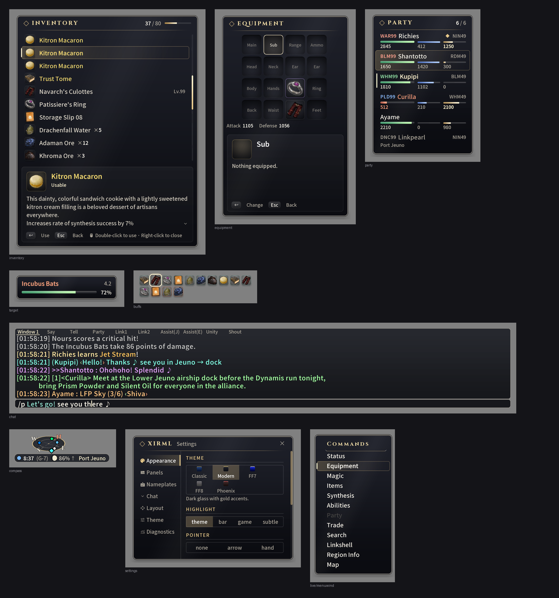
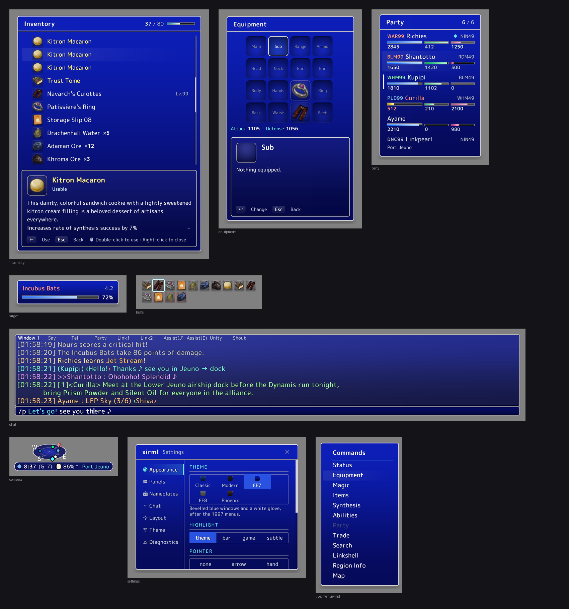
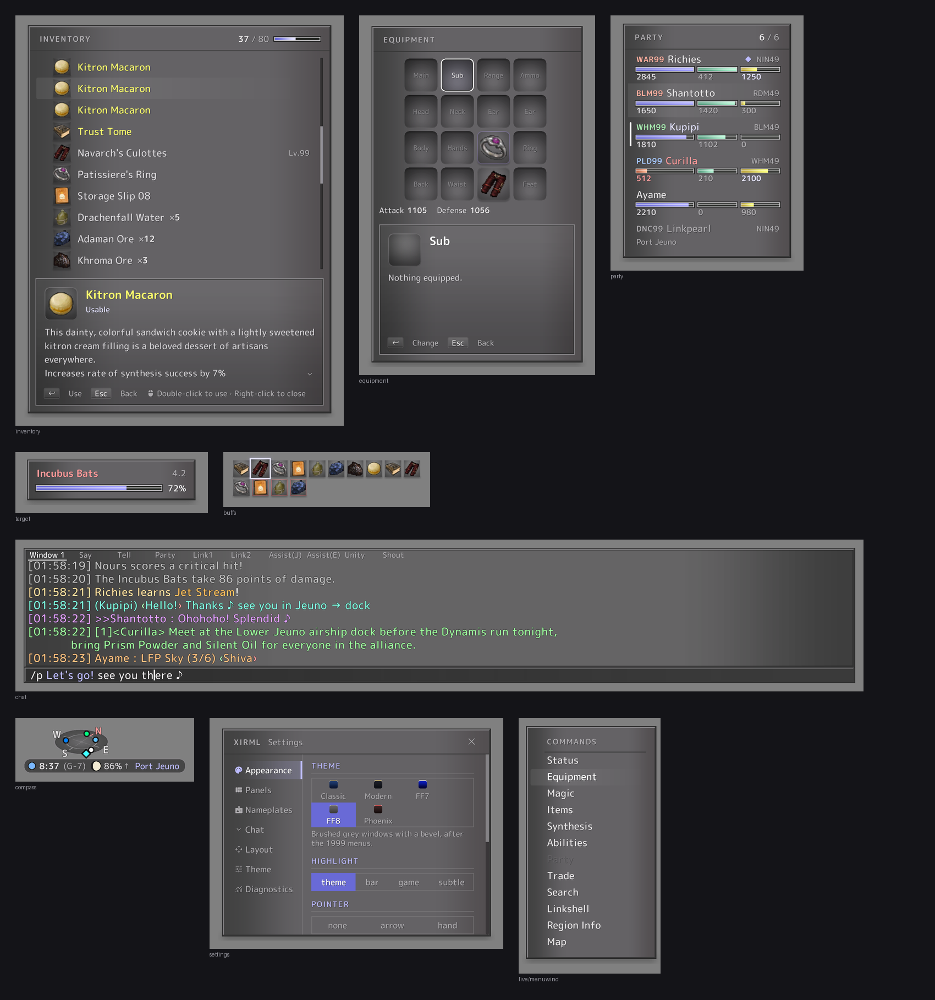
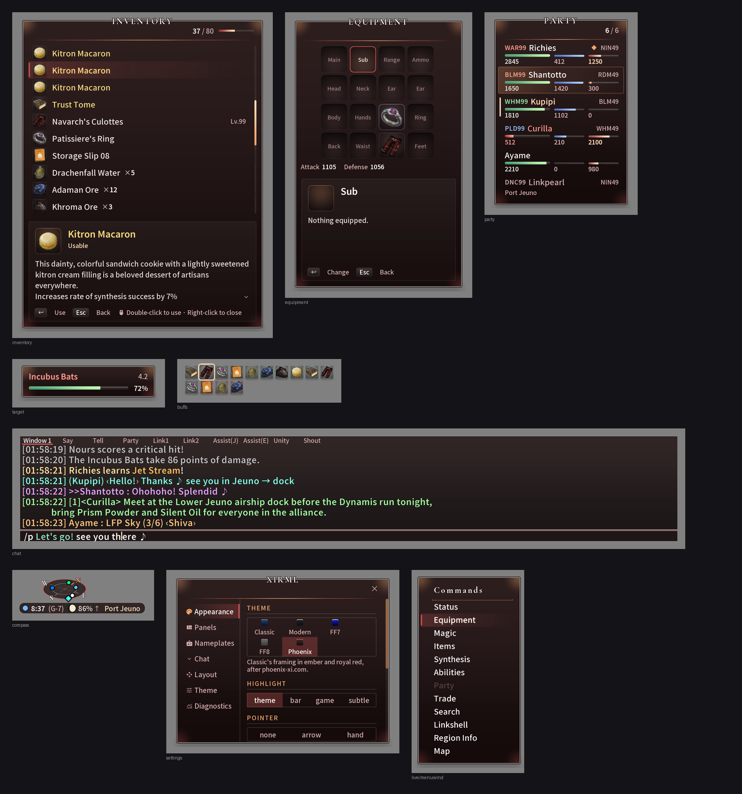

# Gallery

Every panel in every theme, rendered by `tools/gallery.py`. Missing: `classic`, which needs the window art from a game install.

## Modern

Dark glass with gold accents.

## FF7

Bevelled blue windows and a white glove, after the 1997 menus.

## FF8

Brushed grey windows with a bevel, after the 1999 menus.

## Phoenix

Classic's framing in ember and royal red, after phoenix-xi.com.

